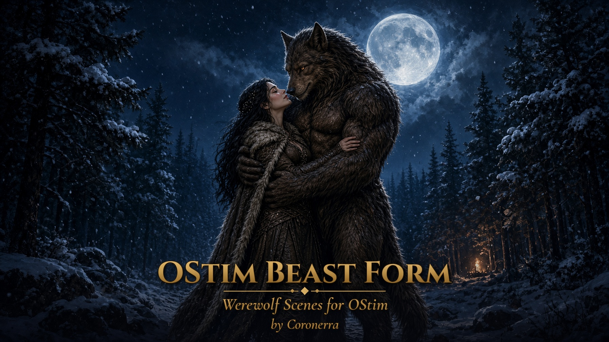

# OStim Beast Form Merged 0.7.2

> **GitHub edition of the mod page.** Download the mod from the **[v0.7.2 release](https://github.com/Coronerra/OStim-Beast-Form-Merged/releases/tag/v0.7.2)** (`OStim_Beast_Form_Merged_0.7.2.zip`). This repo holds the open-source parts: Papyrus sources, SkyrimNet bundles, OStim JSON, the FOMOD installer and docs. AI assistants: start with **[AI_CONTEXT.md](AI_CONTEXT.md)**. History: [CHANGELOG.md](CHANGELOG.md) and [BUILD_NOTES.md](BUILD_NOTES.md). License: [MIT for coronerra's work; third-party assets belong to their authors](LICENSE).

**Skyrim SE / AE · OStim Standalone · ESL-flagged plugins · FOMOD installer · by That Guy (Coronerra)**

> **This is a beta. OStim is required. SexLab is not required, but it should be compatible.**

> **New: [OStim Beast Form Starter Animation Pack](https://www.loverslab.com/files/file/52869-ostim-beast-form-starter-animation-pack/)** (LoversLab exclusive, separate download): Billyy's and Dayelyte's werewolf scenes for this mod, including female werewolf scenes, optional gender patches for Lirael Atelier's packs, and SkyrimNet / OStimNet descriptions.

Play as a werewolf in OStim with your mind intact.

---

## ⚠️ One download for everyone (new in 0.7)

**0.7 replaces every earlier OStim Beast Form download.** There is now **one zip with one installer**, and every setup uses the **[TWO - Total Werewolf Overhaul](https://www.loverslab.com/topic/159911-two-total-werewolf-overhaul/) 4.1 body by Frosferes**. TWO is **required** for everyone and is **not included**. Get it from its LoversLab page.

The installer asks four things:

| Page | Question | Choices |
|---|---|---|
| 1 | **TWO user or Growl user** | **Growl user** (ticked by default, **recommended for Nolvus users**) or **TWO user** (no Growl). Pick one. |
| 2 | **Do you use softbody?** | **No** (ticked by default) or **Yes**. Pick one. |
| 3 | **Hermaphrodite patch? A.K.A. Fruta?** | Optional checkbox, unticked. Only for TWO Extras' herm / urta player werewolf. |
| 4 | **Read and acknowledge** | One required box: "I have read and understand". |

**Read every page.** If you pick the wrong options, the mod won't work.

The old separate downloads are **deprecated**. Their repos and releases stay up, but they are no longer updated: [OStim Beast Form - TWO Edition](https://github.com/Coronerra/OStim-Beast-Form-TWO), [OStim Beast Form Merged - TWO Patch](https://github.com/Coronerra/OStim-Beast-Form-Merged-TWO-Patch), [OStim Beast Form TWO Herm Patch](https://github.com/Coronerra/OStim-Beast-Form-TWO-Herm-Patch) and the original [OStim Beast Form](https://github.com/Coronerra/OStim-Beast-Form). Coming from one of them? See [Updating to 0.7](#updating).

> **About the TWO body:** this mod uses the TWO body made by Frosferes, at the LoversLab community's request. Frosferes is okay with patches but I will not repackage any files he made that I did not have to patch. So non-softbody female bodies and all Male bodies are still dependant on his TWO bodies. Anyone is free to make their own patches, hubs and mods based on this one.

---

## ⚠️ WARNINGS

**1. THIS IS NOT A CREATURE OR CRITTER MOD!** THIS IS A MOD TO UNLOCK ONE OF THE 2 SENTIENT RACES OSTIM LEAVES OUT (WEREWOLVES AND VAMPIRE LORDS). THIS MOD FOCUSES ON THE WEREWOLF. IF IT IS A SUCCESS, I WILL CREATE A VAMPIRE LORDS ONE TO CREATE A WHOLE OSTIM UNDERWORLD MOD.

**2. THIS HAS NO ANIMATIONS.** LIRAEL HAS PROMISED TO MIX HER CONVERTED OSTIM ANIMATION PACKS TO CREATE A MERGER PACK WITH ONLY VAMPIRE LORD AND WEREWOLF ANIMATIONS, FREE FOR THE PUBLIC, WHEN I'M READY TO TRY RELEASING THIS ON NEXUS. IN THE MEANTIME YOU WILL NEED TO USE HER OTHER PACKS.

*The scene menus in this download point at animations from Lirael Atelier's converted OStim packs. If none of her packs are installed, there is nothing to play. The packs used during development (Billyy, BakaFactory, FlufyFox, FunnyBiz) are **not** included, but Lirael has posted many of them **for free on LoversLab**: see [her LoversLab uploads](https://www.loverslab.com/profile/6654496-lauffey/content/?type=downloads_file) (her LoversLab account is **Lauffey**). Links are under Requirements.*

---

## 📖 Description

**This is not a bestiality mod.** It is a sentient race mod. It treats werewolves the same way the game treats Argonians and Khajiit: as people.

When you transform, the game itself changes your race to werewolf. OStim then has no idea what to do with you. This mod fills that gap. As a werewolf you keep the full mind of a sentient being, the way a Khajiit would, and you can be intimate with your partner without first turning back.

If you ever wanted it all in one werewolf (the body, the talking head, the scenes, the cum, NPCs who know what you are) but the mods kept fighting each other, this is as close as I could come to giving you that.

I made this just to see if it could be done. **Everything I made for it is open source.** If you want to make custom bodies, textures or anything else for it, you're welcome to. Go for it.

### What it does (0.7)

**Beast-form scenes**
- A start-scene hotkey that works while transformed. Beast form blocks normal activation, so the mod uses its own key. You set it in the MCM. It can be the same key as OStim's activation key, and that works fine (I use the Up Arrow for both).
- Your beast-form timer pauses during a scene and picks up again when the scene ends.
- OStim recognizes werewolves (and Vampire Lords) as their own actor types, so it picks matching scenes from any installed pack.
- **Hub menus:** the werewolf hub shows one button for each installed pack that has werewolf scenes (for example Baka, Billyy and FlufyFox). Each button opens a page with only that pack's werewolf animations. A werewolf medallion icon takes you back to the main hub. Group hubs (3 to 5 actors) are included too.

**Werewolf body: TWO**
- Werewolves use TWO's bodies, heads, skeleton, SMP and textures (and TWO Alternate Textures, if you use them). You need your own copy of TWO 4.1. TWO's own files are never overwritten.
- **Softbody Yes (since 0.7.2):** female werewolves get a softbody-ready copy of TWO's female body, installed in this mod's own folder (`coronerra\twosoftbody`). It's the same body, textures, morphs and SMP, plus four GT Softbody style bone chains in the vaginal canal and a hidden canal collision mesh, so the canal stretches around a cock instead of the cock passing through it. With softbody **No**, nothing of TWO's female body is shipped or edited.
- **Softbody Yes also installs my OCum script patch (since 0.7.2):** `Scripts/OCumMaleScript.pex` (+ source), the same script as [OCum-Tull-Liquid-Softbody-Patch](https://github.com/Coronerra/OCum-Tull-Liquid-Softbody-Patch) v1.0. It replaces OCum Ascended 4.1.1's `OCumMaleScript` and adds GT Softbody's two OCum fixes (no urethra node offset, which broke SMP collision, and the face-vs-butt aim fix), Tull Animated Creampie / Liquid Pack v2 support and the Scene Change Fix. Without Tull or Liquid Pack it falls back cleanly to OCum's own creampie meshes. It must win over GT Softbody's optional OCum patch file and the Tull/Liquid add-on's copy: keep this mod **below GT - Softbody** in the left pane.
- **Growl option:** Growl keeps its gameplay, and male werewolves keep the limp sheath, penis tip and knot from earlier versions, sitting on TWO's body.
- **TWO option:** the werewolf race stays TWO's. Outside scenes, male genitals are whatever you picked in TWO's own installer.
- **Aroused cock in scenes (male werewolves):** TWO's own hard canine with both choices. With softbody **No** it's TWO's Core file, so nothing extra is needed. With softbody **Yes** (since 0.7.2) it's a copy of that same mesh whose SMP collision is also tagged the way GT Softbody's creature cocks are, so GT Softbody bodies react to it. The GT Softbody (More Nasty Critters) cock and its textures are no longer used or shipped. If OCreatures is loaded, the swap steps aside and lets OCreatures handle it.

**Talking heads**
- TWO's werewolf heads talk and emote through Monster Facial Animation (MFA). The installer also adds the two brow-raise morphs Better Facial Animations (BFA) needs, so BFA works on them too. Without BFA, they are simply unused.
- Vampire Lord heads are separate talking head parts. Their meshes and morphs come from MFA itself (since 0.7.1 this mod doesn't ship any Vampire Lord meshes).

**Beast climax (OCum)**
- When a **male werewolf** climaxes in any OStim scene, his partner gets a massive load. That includes your scenes and NPC-only scenes. Werebears and Vampire Lords are handled the same way.
  - **Vaginal / anal:** heavy creampie overlays, plus Tull/Liquid creampie meshes if you have those mods.
  - **Footjob, handjob, masturbation and other outside finishes:** belly, chest, butt and legs are covered, plus feet or hands where it fits. OCum's cum-shot spurts also play on outside finishes in your own scenes.
  - **Blowjob / oral:** not swallowed. Her face, mouth, neck and chest are left covered and dripping.
  - **Huge load** (on by default): OCum's heaviest textures on every area, the full mesh set, and the beast never runs dry.
- This works whatever OCum's own MCM says about meshes, vaginal/anal overlays or creampie chance.
- **Multi-round stacking** (on by default): if OStim keeps the scene going after he cums, each climax adds another layer and more meshes. **Max stacked rounds** goes from 1 to 10, default 5.
- **How long it lasts:** it follows OCum's cleanup timer, which defaults to about 5 real minutes. Raise OCum's "cum cleanup timer" for longer. It washes off in water like normal OCum cum.
- After the scene, meshes are only put back on while she's naked, so they never fight her armor.
- ⚠️ **Ring slot:** the torso drip mesh uses slot 36, the ring slot. A ring she's wearing comes off while the torso drip is on.

**Hermaphrodite (Fruta) option**
- For TWO Extras' herm / urta **player** werewolf (TWO Extras' "Toggle Herm Werewolf" spell). OStim then treats your herm or urta werewolf as having a penis as well as a vagina and breasts, so the male-werewolf-role scenes can be offered. The aroused cock and Beast Load climax run for her too. Regular female werewolves (including Aela) are unchanged.
- Needs TWO Extras (`WerewolvesExtras.esp`) and everything it masters (see [Hermaphrodite option only](#herm-req)), and TWO's `WerewolvesExtrasGrowl.esp` if you use Growl. On Skyrim 1.7.99 or newer, TWO's herm body swap doesn't work yet (see [TWO's skin swapper](#skinswapper)). Leave OStim's MCM option "Futas use male role" on (the default).
- I am not going to test this myself. If you use TWO's herm or urta werewolf, please test it and report any problems in the support section of the [OStim Beast Form Merged](https://www.loverslab.com/files/file/52768-ostim-beast-form-merged/) page on LoversLab.

**SkyrimNet / OStimNet (optional)**
- **Beast Aware:** SkyrimNet NPCs are told when you shift into or out of beast form.
- **Beast Form OStimNet Bridge:** while you're a werewolf or Vampire Lord, nearby NPCs know they can still pick you as an OStimNet partner. They still decide by their own personality. Leave OStimNet's "Nearby actors humanoid only" **ON**.
- OStimNet scene descriptions are included for this mod's own scenes.

**MCM: OStim Beast Form**
- Start-scene hotkey, fallback search radius, Try StopCombat, Pause beast timer for ANY OStim scene, and debug messages.
- **Beast climax (OCum):** Werewolf/VL cum on partner, Huge load, Tull/Liquid meshes, Spurts on outside finishes, Stack cum across rounds, and Max stacked rounds (1 to 10).

### 🐾 Vampire Lords
Vampire Lord support is early groundwork: actor typing, hubs, the aroused swap, climax handling and talking heads. It is **not finished**. A full Vampire Lord release is planned if the werewolf release goes well.

### 🙏 CALL FOR HELP: FEMALE WEREWOLF ANIMATIONS
This works fine for **male** werewolves. **Female werewolf scenes are not bundled with this mod.** The female werewolf body now comes from TWO, and the mod includes a female werewolf + man hub and a female werewolf + woman hub that separate, optional scene packs can add buttons to. Without such a pack, the female werewolf + man hub is just an idle with no buttons.

**Female werewolf scenes are available now** in the separate, LoversLab-exclusive **[OStim Beast Form Starter Animation Pack](https://www.loverslab.com/files/file/52869-ostim-beast-form-starter-animation-pack/)**: Dayelyte's female werewolf scenes and Billyy's werewolf scenes, ready for this mod's hubs. Details are on its page.

**Animators, this is a call-out to you.** If you can make female werewolf scenes, or want to try, please get in touch in the support thread. The community can help too: test, give feedback and spread the word. The body is waiting. It needs animations.

---

## 📋 Requirements

Get every requirement from its original page and support its author. **Nothing below is bundled** unless I say so.

### Everyone
- **[TWO - Total Werewolf Overhaul](https://www.loverslab.com/topic/159911-two-total-werewolf-overhaul/) 4.1** by **Frosferes** (LoversLab). Core is required. See [TWO installer choices](#two-choices).
- **[Monster Facial Animation (MFA) - Special Edition](https://www.nexusmods.com/skyrimspecialedition/mods/22878)** (`MonsterLipSync1.esp`). It is a **hard master** of TWO and of this mod's plugins. The game won't start without it.
- [OStim Standalone](https://www.nexusmods.com/skyrimspecialedition/mods/98163) by **VersuchDrei** and the OStim team (`OStim.esp`)
- [OCum Ascended](https://www.nexusmods.com/skyrimspecialedition/mods/77506) by **Aietos** (with OsmosisWrench and Sairion350) (`OCum.esp`)
- [SKSE64](https://skse.silverlock.org/), [Address Library for SKSE Plugins](https://www.nexusmods.com/skyrimspecialedition/mods/32444) (**meh321**), [SkyUI](https://www.nexusmods.com/skyrimspecialedition/mods/12604) (**schlangster**), [PapyrusUtil SE](https://www.nexusmods.com/skyrimspecialedition/mods/13048) (**exiledviper** and **meh321**), [RaceMenu](https://www.nexusmods.com/skyrimspecialedition/mods/19080) (**expired6978**), [powerofthree's Papyrus Extender](https://www.nexusmods.com/skyrimspecialedition/mods/22854) (**powerofthree**), [XPMSSE](https://www.nexusmods.com/skyrimspecialedition/mods/1988) (**Groovtama**)
- [FSMP - Faster HDT-SMP](https://www.nexusmods.com/skyrimspecialedition/mods/57339) by **DaydreamingDay** and contributors (TWO's physics)
- **Pandora** or another behavior engine: [Pandora Behaviour Engine+](https://www.nexusmods.com/skyrimspecialedition/mods/133232) by **Monitor221hz**. This mod adds a small set of fallback animation events, so you have to regenerate behaviors.
- **At least one OStim animation pack with werewolf scenes.** Right now that means **Lirael Atelier's** converted packs. Many of them are **free on LoversLab**: [all of Lirael's LoversLab uploads](https://www.loverslab.com/profile/6654496-lauffey/content/?type=downloads_file) (account **Lauffey**). Built and tested against:
  - OCreatures - Billyy Animation Pack COMPLETE (animations by **Billyy**): [Byllis Creature Animation pack Complete - OStim edition](https://www.loverslab.com/files/file/51449-byllis-creature-animation-pack-complete-ostim-edition) (free on LoversLab)
  - FlufyFox OStim - Creatures v0.5.2 (animations by **FlufyFox**): [FluffyFox Creatures animation pack - OStim Conversion](https://www.loverslab.com/files/file/51860-fluffyfox-creatures-animation-pack-) (free on LoversLab)
  - FunnyBiz OStim - Creatures v0.2.3 (animations by **FunnyBiz**, Vampire Lord): [FunnyBiz Creature Animations for OStim Standalone](https://www.loverslab.com/files/file/52667-funnybiz-creature-animations-for-ostim-standalone) (free on LoversLab)
  - OCreatures - Baka Animation Pack v0.1-dev (animations by **BakaFactory**): the creature version isn't on LoversLab yet. Check [Lirael's Patreon](https://www.patreon.com/LiraelAtelier).
  - You can support Lirael on [Patreon](https://www.patreon.com/LiraelAtelier). Her free updates and new conversions are posted there too.
- **Other OStim animation packs that include werewolf animations may work, but they haven't been tested yet.** Please report what you find.

### Growl option only
- [Growl - Werebeasts of Skyrim](https://www.nexusmods.com/skyrimspecialedition/mods/31245) by **EnaiSiaion** (hard master)
- [JS Emissive Eyes SE](https://www.nexusmods.com/skyrimspecialedition/mods/60108) by **johnskyrim** (hard master)
- TWO's own Growl patch (`WerewolvesGrowl.esp`, ticked in TWO's installer)

### Softbody Yes only
- [SOFTBODY (GT - Softbody)](https://www.nexusmods.com/skyrimspecialedition/mods/152103) by **Goutou** (see its own requirements). Pick **No** on the softbody page if you don't run it. That includes UNP users, and CBBE or UBE users without softbody.
- Softbody Yes installs this mod's copy of `Scripts/OCumMaleScript.pex` (OCum + Tull/Liquid + GT Softbody merged script). Load this mod **after GT - Softbody** in the left pane so it wins over GT's optional OCum patch.

### Hermaphrodite option only
- TWO Extras (`WerewolvesExtras.esp`, part of TWO), plus `WerewolvesExtrasGrowl.esp` if you use Growl.
- **TWO Extras pulls in TWO's HCOS stack.** In TWO 4.1, `WerewolvesExtras.esp` masters `WerewolvesHCOS.esp`, and that one masters `CreatureFramework.esm` (Creature Framework), `MoreNastyCritters.esp` (More Nasty Critters) and `HornyCreatures.esp` (Horny Creatures of Skyrim). All of them have to be installed and enabled, or the game won't start. Check each mod's page for its own requirements. Our herm plugin itself only masters `Skyrim.esm` and detects TWO Extras at runtime.
- TWO Extras' herm / urta body swap needs TWO's `TWO_SkinSwapper.dll`, which doesn't load on Skyrim 1.7.99 or newer yet. See [TWO's skin swapper and Skyrim 1.7.99+](#skinswapper).

### Not needed any more
HDT Werewolves, Animated Beast's Cocks (ABC) and SOS are **not** needed. Creature Framework, More Nasty Critters and HCOS are **not** needed **unless you use the Hermaphrodite option** (see above). SexLab is **not required**, but it should be compatible. **HDT Werewolves must be off:** its plugin is also named `Werewolves.esp` and cannot run next to TWO.

### Optional
- [Better Facial Animations (BFA)](https://www.nexusmods.com/skyrimspecialedition/mods/193598) by **Cyberquach**. In BFA's race filters, tick **WerewolfBeastRace** and **DLC1VampireBeastRace**.
- [OCreatures Reforged](https://dwemermods.com/mods/5173) 0.1.9 by **Lirael Atelier** ([Patreon](https://www.patreon.com/LiraelAtelier)). **Not required, but fully compatible.** See **OCreatures Reforged compatibility** below.
- [SkyrimNet](https://www.nexusmods.com/skyrimspecialedition/mods/198346) by **MinLL** and the SkyrimNet team, [OStimNet](https://dwemermods.com/mods/2761) by **tetherball88**, and [OStim Navigator](https://github.com/tetherball88/OStimNavigator) by **tetherball88**. These are needed for Beast Aware and the OStimNet bridge.
- [Tull Animated Creampie](https://dwemermods.com/mods/3535) by **Tullius Channel** and **Emotional Trash Can**, plus **[Predator] Liquid Pack v2** by **PredatorRJ**. Without them you still get all of OCum's textures.
- [OCum Ascended - Tull and Liquid Pack Meshes](https://dwemermods.com/mods/5304) by **Blacksheepo815**, and my [OCum + Tull/Liquid + GT Softbody merged script patch](https://github.com/Coronerra/OCum-Tull-Liquid-Softbody-Patch). Since 0.7.2, softbody **Yes** installs that script for you (you can disable the separate patch). With softbody **No**, keep it as its own mod if you want it.
- TWO - Alternate Textures (textures only; any choice is fine).
- **Ostrands with Werewolves** (separate download, see [below](#ostrands)).
- **[OStim Beast Form Starter Animation Pack](https://www.loverslab.com/files/file/52869-ostim-beast-form-starter-animation-pack/)** (LoversLab exclusive, separate download): werewolf scenes by Billyy and Dayelyte for this mod's hubs (needs Pandora).

---

## 🚫 Known Incompatibilities (as of this release)

- **[Diverse Werewolves Collection SE](https://www.nexusmods.com/skyrimspecialedition/mods/7009)** by **opusGlass**: with it installed, the camera locks to the sides. Leave it off with this mod.
- **[TWO's TWO_SkinSwapper.dll (v0.2.1, part of TWO Extras)](https://www.loverslab.com/topic/159911-two-total-werewolf-overhaul/)** by **Frosferes**: it does not load on Skyrim SE 1.7.99 / 1.7.104 or newer, because it doesn't support the new Address Library format. TWO's gender / herm skin spells then have no effect. This is a limit of TWO's DLL and the game version, not a bug in this mod. This mod's Hermaphrodite option doesn't use that DLL, but TWO's herm / urta body is swapped in by it, so on those game versions use 1.6.1170 (or GOG 1.6.1179) for the herm body until TWO's DLL is updated.
<!-- Further known incompatibilities go here (tool/incompat072.py). -->

---

## 🐺 TWO installer choices

Install TWO 4.1 with its own installer **before** this mod:
- **Core:** yes (required).
- **Genitals:**
  - Growl option: **None**. This mod already gives male werewolves the sheath. Picking CF, HCOS or SOS would give a second set at rest.
  - TWO option: your choice. CF Standalone needs Creature Framework, HCOS needs Horny Creatures of Skyrim, SOS needs Schlongs of Skyrim. "None" is fine too.
- **Extras:** only if you want TWO Extras (needed for the Hermaphrodite option).
- **Wicked Werewolves skeleton:** **OFF.** It changes proportions, and OStim animations won't line up.
- **Misc patches:** **Growl ON** if you use Growl. Moonlight Tales only if you use it (and turn off its skin system).

BodySlide is optional. TWO already ships default bodies and heads. If you do build, send the output to its **own** mod **below** TWO in the left pane.

---

## 🛠️ Installation (Mod Organizer 2)

1. Install every requirement above, including TWO 4.1 with the choices above. **Disable HDT Werewolves.**
2. **If you used any earlier OStim Beast Form download, read [Updating to 0.7](#updating) first.**
3. Install **OStim_Beast_Form_Merged_0.7.zip** with MO2 ("Install a new mod from archive"). Answer the four installer pages.
4. Put it in the **left pane** as shown below, then set the **right pane** (plugin order).
5. **Run Pandora** (or your behavior engine) to regenerate behaviors.
6. Load your game, wait for SkyUI to register the MCM, then open **OStim Beast Form** and **set the Start scene hotkey**. It can be the same key as OStim's activation key. That works fine; I use the Up Arrow for both.
7. Transform, get out of combat, face your partner up close and press the hotkey.

**Uninstalling:** don't uninstall mid-scene. Disable the mod outside a scene, in normal form. Removing script mods mid-playthrough is always at your own risk.

### Updating to 0.7 / 0.7.1 / 0.7.2

Before any update: in game, change back to human form, leave any scene and save. Then close the game **and** MO2, and back up your profile and old mod folders. Reinstall over the old mod with MO2's **Replace**, so files that 0.7 no longer uses are removed.

| You had… | Pick in the installer | Then… |
|---|---|---|
| **Merged 0.7.1** | The same options as before | Install 0.7.2 with MO2 **Replace**. Same plugin names and FormIDs, so your save keeps working. Softbody **No**: nothing changed. Softbody **Yes**: the scene cock is now TWO's hard canine (softbody-ready) instead of the GT Softbody cock, and female werewolves get the softbody-ready TWO body. Transform back to human form before you save and update. No Pandora run needed. |
| **Merged 0.7** | The same options as before | Install 0.7.1 with MO2 **Replace**. The plugins didn't change, so your save keeps working. 0.7.1 only removes the Vampire Lord meshes, head morphs and textures that other mods (MFA, OCreatures Reforged) already provide. No Pandora run needed. |
| **Merged 0.6 + Merged TWO Patch 0.1** | **Growl**. Softbody **Yes** if you run GT - Softbody (that's the look you had). | **Disable or remove the old "TWO Patch" mod.** 0.7 now contains its plugin. Same plugin names and FormIDs, so **your save keeps working**. If you used the Herm Patch, tick the Hermaphrodite option and remove the old Herm Patch mod too. No new animations, so no Pandora run is needed. |
| **Plain Merged 0.6 (no TWO Patch)** | **Growl** | This is a **body switch**: install TWO 4.1 (Core + Growl patch) and MFA, and disable HDT Werewolves. `OStim_Beast_Form_Merged.esp` keeps its name and FormIDs, so the save keeps working, but your werewolves now look like TWO instead of the HDT / ABC bodies. You may get a one-time missing-content prompt from HDT Werewolves' old plugin; that's harmless. |
| **OStim Beast Form - TWO Edition 0.2** | **TWO** | Remove the old TWO Edition mod. Same plugin name and FormIDs, so your save keeps working. |
| **OStim Beast Form TWO Herm Patch 0.1** | Tick **Hermaphrodite** | Remove the old Herm Patch mod. Same plugin. |
| **The original OStim Beast Form, Beast Lite, Beast Aware, OCum Werewolf Shot, OCum Beast Pie or BeastForm BFA Heads** | Either | Disable them. They're all merged in here. Running both doubles things up. |

**Never enable `OStim_Beast_Form_TWO.esp` together with `OStim_Beast_Form_Merged.esp`.** They share the same scripts. Switching an existing save between the Growl and TWO options isn't supported; start a new game for that.

---

## 📑 Load Order

### Left pane (MO2 install / overwrite order), with WHY

Lower in the left pane = wins file conflicts. 0.7.2 changes only the softbody **Yes** files (rows 2, 5 and 10 below). I compared the 0.7.1 package file-by-file against TWO 4.1 (all folders), TWO Alternate Textures 4.0, MFA, OStim 7.5.1c, OCum Ascended 4.1.1, OCum Tull/Liquid Meshes + Scene Change Fix, GT Softbody 3.37.2, OCreatures Reforged 1.9, Growl (plugin + BSA contents), JS Emissive Eyes, BFA 5.0.6, Ostrands with Werewolves 0.8.0.3, OCum Werewolf Shot 1.0, and ABC (BakaFactory).

| # | Mod | Why here |
|---|---|---|
| 1 | SKSE frameworks, XPMSSE, FSMP | No file overlap with this mod. TWO has to beat them on werewolf skeleton/body files (see #10). |
| 2 | OStim Standalone, OCum Ascended (+ Tull/Liquid add-ons and patches) | Softbody **No**: no overlap. Softbody **Yes** (since 0.7.2): this mod ships the merged `Scripts/OCumMaleScript.pex` and **must win** it over OCum and the Tull/Liquid add-on. |
| 3 | Monster Facial Animation | **No overlap since 0.7.1**, so its spot relative to this mod doesn't matter. (0.7 shipped copies of MFA's Vampire Lord meshes and overwrote its VL head TRIs; those are gone.) |
| 4 | Growl, JS Emissive Eyes (Growl path) | No overlap. Growl's assets are in a BSA, and loose files beat BSAs anyway. |
| 5 | GT - Softbody (softbody Yes) | Since 0.7.2 the only shared file is `Scripts/OCumMaleScript.pex` from GT's optional OCum patch: **this mod must win it**. GT's werewolf cock meshes are no longer shipped (up to 0.7.1 they were byte-identical copies). |
| 6 | OCreatures Reforged (optional) | **This mod must win.** We overwrite OCR's werewolf/VL idle scene JSONs (`ocrwerewolfidle*.json`, `ocrvampirelordidlefm.json`) to hook our hubs. (Up to 0.7.1, softbody Yes also overwrote its three `addon_dog*.nif` werewolf meshes.) |
| 7 | Animation packs | No overlap. |
| 8 | OStrands, then Ostrands with Werewolves (optional) | No overlap with this mod. Ostrands with Werewolves must sit below OStrands so its DLL wins. |
| 9 | **OStim Beast Form Merged 0.7.2** | — |
| 10 | **TWO 4.1**, then TWO Alternate Textures, then your BodySlide output (own mod) | This mod and TWO share **no** files: since 0.7.2 the softbody Yes copies of TWO's female body and hard canine use this mod's own folder (`coronerra\twosoftbody`), and the MNC textures are no longer shipped. So their relative order is free. TWO **must** win against OCR and ABC, which ship the werewolf `skeleton.nif/.hkx`, body meshes and body/head textures. Alternate Textures overwrites TWO's normal maps by design. |
| 11 | Better Facial Animations (optional) | No overlap with this mod or TWO. |
| 12 | Pandora Output | Generated behaviors. We ship no behavior files. |

**Nolvus:** keep all of the above **above the Paper Maps mods**. In a Nolvus left pane, the Paper Maps block sits at the very bottom, below Pandora Output.

**TWO's SOS genitals + GT Softbody:** if a TWO user picks SOS genitals in TWO's installer and also runs GT Softbody, those two mods overwrite each other's `sos/*/werewolfgenitals_0/1.nif`. That's between TWO and GT Softbody, not this mod. Pick which one you want to win.

### Right pane (plugin order), with WHY

**Growl path**
1. Skyrim.esm … Dragonborn.esm
2. JS Emissive Eyes SE - Johnskyrim.esp, OStim.esp, OCum.esp, TT_OStimNet.esp (optional)
3. MonsterLipSync1.esp
4. Growl - Werebeasts of Skyrim.esp, then its patches
5. OCreatures.esp (optional)
6. Werewolves.esp, WerewolvesGrowl.esp (+ WerewolvesExtras.esp / WerewolvesExtrasGrowl.esp for herm)
7. **OStim_Beast_Form_Merged.esp**
8. **OStim_Beast_Form_Merged_TWO_Patch.esp**
9. **OStim_Beast_Form_Merged_TWO_Patch - BFA Heads.esp**
10. **OStim_Beast_Form_TWO_Herm_Patch.esp** (herm only)

**TWO path**
1. Skyrim.esm … Dragonborn.esm
2. OStim.esp, OCum.esp, TT_OStimNet.esp (optional)
3. MonsterLipSync1.esp
4. OCreatures.esp (optional)
5. Werewolves.esp, then any other Werewolves*.esp you use
6. **OStim_Beast_Form_TWO.esp**
7. **OStim_Beast_Form_TWO - BFA Heads.esp**
8. **OStim_Beast_Form_TWO_Herm_Patch.esp** (herm only)

**Why:**
- **Masters first.** `OStim_Beast_Form_Merged.esp` masters Skyrim/Update/Dawnguard/Dragonborn, JS Emissive Eyes, Growl, OStim and OCum. The TWO Patch masters MFA, `Werewolves.esp` and `OStim_Beast_Form_Merged.esp`. The BFA Heads plugins master MFA and `Werewolves.esp`. `OStim_Beast_Form_TWO.esp` masters `Werewolves.esp`, MFA, OStim and OCum.
- **Our race edits have to win.** The werewolf race is edited by Growl, OCR, TWO and TWO's Growl/Extras patches. Our plugins go after all of them, so their race edits are the last ones loaded. On Growl, the TWO Patch carries the merged TWO + Growl + OStim race and must sit directly below `OStim_Beast_Form_Merged.esp`.
- **`Werewolves.esp` after `OCreatures.esp`**, or TWO's heads go missing. We restore OCR's race keywords at runtime, so OCR scenes still work.
- **Herm last.** It only masters `Skyrim.esm`, so it doesn't matter technically, but keep it at the end of ours.
- **Nolvus: nothing below Paper Maps.** Put our plugins as low as you like, but **above `FWMF for Fantasy Paper Maps.esp`** and the other Paper Map plugins (the last of them is `Nolvus Awakening Paper Map Patch.esp`). **Don't run LOOT.** Place plugins by hand.
- **Never enable `OStim_Beast_Form_TWO.esp` and `OStim_Beast_Form_Merged.esp` together.** They share scripts. The installer never installs both.

### Must be off
- **HDT Werewolves.** Its plugin is also called `Werewolves.esp`, so it can't coexist with TWO.
- **Animated Beast's Cocks.** It ships `malebodywerewolf_0/1.nif`, the werewolf `skeleton.nif/.hkx` and the werewolf body/head textures, all of which collide with TWO Core.
- Old patches built for HDT Werewolves (for example "MFA and Growl Patch" / `MFA-Growl-HDTWW_Patch.esp`).
- **OCum Werewolf Shot.** Its urethra node is in here, byte-identical.
- The old OStim Beast Form, Beast Lite, Beast Aware, OCum Beast Pie and BeastForm BFA Heads mods.
- The old TWO Edition / TWO Patch / Herm Patch mods.

---

## 🤝 OCreatures Reforged (OCR) compatibility

**OStim Beast Form Merged 0.7.2 is compatible with [OCreatures Reforged](https://dwemermods.com/mods/5173) 0.1.9 by Lirael Atelier.** You can use it with or without OCR.

- **Load this mod below OCR**, and put this mod's plugins after `OCreatures.esp`. `Werewolves.esp` (TWO) also goes after `OCreatures.esp`.
- OCR is **not** a master, so it can be on or off.
- **With OCR on:** this mod's aroused swap detects `OCreatures.esp` and steps aside, so OCR owns the aroused bodies and you never get a double cock. OCR's werewolf and Vampire Lord race keywords are put back at runtime (this needs powerofthree's Papyrus Extender).
- **With OCR off:** this mod registers werewolves and Vampire Lords with OStim itself, provides the idle and hub scenes, and handles the aroused swap.
- **Coming soon:** Lirael's next OCR release is planned as a **formal, free public release**. This mod will be patched for it once it's out.

👉 Get Lirael's free converted animation packs from **[her LoversLab uploads](https://www.loverslab.com/profile/6654496-lauffey/content/?type=downloads_file)**, and support her work on **[Patreon](https://www.patreon.com/LiraelAtelier)**.

---

## 🧵 Ostrands with Werewolves (separate download)

OStrands stays a **separate, optional download**, because not everyone wants OStrands: **[Ostrands with Werewolves 0.8.0.3](https://github.com/Coronerra/Ostrands-with-Werewolves/releases/tag/v0.8.0.3)** ([source on GitHub](https://github.com/Coronerra/Ostrands-with-Werewolves)). It is a drop-in replacement for the OStrands DLL that adds **female werewolf** support. **No new OStrands build is needed for 0.7:** TWO's skeleton has every bone OStrands uses, at the same positions, and female werewolves get TWO's real vagina and anus bones.

**Credits, in order:**
1. **Original mod:** [OStrands - Procedural Fluid for OStim Standalone](https://www.nexusmods.com/skyrimspecialedition/mods/195115) by **LeonVanWinkle (Saint)** ([source on GitLab](https://gitlab.com/LilRicefield/ostrands)).
2. **The modified LoversLab version ours is based on:** [OStrands creature support patch for SexLab/OCreatures](https://www.loverslab.com/files/file/52392-ostrands-creature-support-patch-for-sexlabocreatures) (0.8.0.2) by **Keevan2374**, with contributions from **crajjjj** ([source on GitLab](https://gitlab.com/Keevan2374/ostrands)).
3. **Ostrands with Werewolves 0.8.0.3** by coronerra (That Guy (Coronerra)): [source on GitHub](https://github.com/Coronerra/Ostrands-with-Werewolves).

It's licensed under the **GNU GPL v3**, the same as OStrands, and the license and full source come with it. **Requires OStrands' own requirements.** Install it below OStrands in MO2 so its DLL wins.

---

## 🏆 Credits

This mod stands on a lot of other people's work. Thank you all. "Bundled" means a file from that work is inside the 0.7.2 download. Everything else is required, optional or referenced, and you get it from its own page.

**This mod**
- **That Guy (Coronerra)**: OStim Beast Form Merged and everything merged into it: OStim Beast Form, Beast Lite (fallback scenes), Beast Aware (SkyrimNet), OCum Werewolf Shot, Beast Pie / Beast Load (OCum beast climax), the Beast Form OStimNet bridge, the TWO plugins and TWO patch, the softbody and Hermaphrodite (Fruta) options, the hub menus and pack pages, the MFA/BFA head-morph work, the werewolf medallion icon, all Papyrus scripts, the MCM, the SkyrimNet prompts, the OStim actor/hub JSON, the FOMOD installer and the docs.

**Werewolf body and heads**
- **Frosferes**: [TWO - Total Werewolf Overhaul](https://www.loverslab.com/topic/159911-two-total-werewolf-overhaul/). Werewolf bodies, heads, skeleton, SMP physics and textures, plus the hard canine (`CanineRedHard.nif`) used for softbody "No". Required. Frosferes is okay with patches but I will not repackage any files he made that I did not have to patch. So non-softbody female bodies and all Male bodies are still dependant on his TWO bodies. The only TWO-derived files shipped are the softbody Yes copies of TWO's female body (`femalebodywerewolf_0/_1.nif`, `femalebodywerewolf.tri`) and hard canine (`CanineRedHard.nif`), the two softbody SMP configs built from TWO's XMLs, and the BFA head TRI (`ExpHeadWerewolf_BFA.tri`). Each one is edited, at this mod's own paths.
- **TealEri (aka CinnaMewRoll)**: [Monster Facial Animation (MFA)](https://www.nexusmods.com/skyrimspecialedition/mods/22878) and Expressive Werebeasts, the base of TWO's talking heads. MFA is required. It also provides the Vampire Lord heads, eyes, headless VL bodies and VL head morphs (TRI) our plugins use. **Not bundled** since 0.7.1 (up to 0.7, copies of them and an extended VL head TRI were bundled). (MFA's Nexus page now shows the uploader as User_1926808. TWO's credits name TealEri as MFA's creator.)
- **BakaFactory**: Animated Beast's Cocks (ABC). Bundled: the Growl option's resting sheath, tip and knot are ABC geometry.

**Animations**
- **Billyy**: the werewolf and Vampire Lord animations this mod is built around. **Billyy gave full permission** for the Billyy files bundled here: 21 stage-1 fallback poses (HKX) and the Billyy werewolf/VL scene and hub files.
- **Lirael Atelier** (LoversLab: **Lauffey**, [Patreon](https://www.patreon.com/LiraelAtelier)): **OStim conversion and packaging** of Billyy's creature animations ([Byllis Creature Animation pack Complete - OStim edition](https://www.loverslab.com/files/file/51449-byllis-creature-animation-pack-complete-ostim-edition)), FluffyFox's ([FluffyFox Creatures - OStim Conversion](https://www.loverslab.com/files/file/51860-fluffyfox-creatures-animation-pack-)) and FunnyBizness's ([FunnyBiz Creature Animations for OStim Standalone](https://www.loverslab.com/files/file/52667-funnybiz-creature-animations-for-ostim-standalone)) and BakaFactory's (OCreatures - Baka Animation Pack, on her [Patreon](https://www.patreon.com/LiraelAtelier)), and [OCreatures Reforged](https://dwemermods.com/mods/5173). The bundled fallback poses were taken from her conversion of Billyy's pack. The bundled pack scene files are edited copies of her converted scene data, re-routed to this mod's hubs. **Lirael did not make the animations.** The hub layout follows OCreatures' design.
- **BakaFactory**: the original animations in the Baka creature pack (Lirael did the OStim conversion; BakaFactory made the animations). Bundled: edited copies of that pack's werewolf/VL scene files (hub routing only).
- **FluffyFox**: the original animations in the FluffyFox creature pack. Bundled: edited copies of its werewolf scene files (hub routing only).
- **FunnyBizness**: the original Vampire Lord animations in the FunnyBiz pack. Bundled: edited copies of its VL scene files (hub routing only).

**Frameworks and requirements**
- **Kannonfodder, VersuchDrei** and the OStim team: [OStim Standalone](https://www.nexusmods.com/skyrimspecialedition/mods/98163) (hard master).
- **Aietos**, with **OsmosisWrench** and **Sairion350**: [OCum Ascended](https://www.nexusmods.com/skyrimspecialedition/mods/77506) (hard master). Bundled: the werewolf urethra node, based on OCum's, and (softbody Yes, since 0.7.2) a modified copy of OCum's `OCumMaleScript`.
- **EnaiSiaion**: [Growl - Werebeasts of Skyrim](https://www.nexusmods.com/skyrimspecialedition/mods/31245) (Growl option hard master; its werewolf race is the base of the Growl option's race edit).
- **johnskyrim**: [JS Emissive Eyes SE](https://www.nexusmods.com/skyrimspecialedition/mods/60108) (Growl option hard master; its glowing-eye spells are kept).
- **Goutou**: [SOFTBODY (GT - Softbody)](https://www.nexusmods.com/skyrimspecialedition/mods/152103). The softbody TWO body's canal bone chains, physics values and collision tags follow GT Softbody's female setup, and the softbody Yes `OCumMaleScript` includes GT Softbody's two OCum script fixes. GT's three MNC werewolf cock meshes were bundled up to 0.7.1, not since 0.7.2.
- **The More Nasty Critters (MNC) author**: the MNC werewolf cock textures were bundled with softbody "Yes" up to 0.7.1 (not since 0.7.2). The Vampire Lord aroused swap points at the MNC Vampire Lord mesh path; that mesh and its textures are **no longer bundled** since 0.7.1.
- **J0suk3_** (original OCreatures) and **chrystelle** (OCreatures Revived): the idle/hub scene registration this mod plugs into. Bundled: edited copies of OCR's werewolf/VL idle scene files.
- **SKSE team**: SKSE64. **meh321**: Address Library. **exiledviper** and **meh321**: PapyrusUtil SE (used for the loose-file mesh check). **powerofthree**: Papyrus Extender (restores OCR race keywords). **expired6978**: RaceMenu. **schlangster** and the SkyUI team: SkyUI (MCM). **Groovtama**: XPMSSE.
- **hydrogensaysHDT** (original HDT-SMP), **DaydreamingDay** and the FSMP contributors: [FSMP - Faster HDT-SMP](https://www.nexusmods.com/skyrimspecialedition/mods/57339) (TWO's physics).
- **Pandora Behaviour Engine Team** (**Monitor221hz**): [Pandora Behaviour Engine+](https://www.nexusmods.com/skyrimspecialedition/mods/133232).

**Optional add-ons**
- **Cyberquach**: [Better Facial Animations](https://www.nexusmods.com/skyrimspecialedition/mods/193598). The head-morph extension exists so BFA can animate TWO's werewolf heads.
- **MinLL** and the SkyrimNet team: SkyrimNet (Beast Aware and the OStimNet bridge plug into its API).
- **tetherball88**: OStimNet and OStim Navigator.
- **Tullius Channel** and **Emotional Trash Can**: [Tull Animated Creampie](https://dwemermods.com/mods/3535). **PredatorRJ**: [Liquid Pack v2](https://dwemermods.com/mods/330). **Blacksheepo815** (DwemerMods): OCum Ascended - Tull and Liquid Pack Meshes and its Scene Change Fix (their Tull/Liquid script code and the Scene Change Fix are part of the softbody Yes `OCumMaleScript`).
- **LeonVanWinkle (Saint)**: [OStrands](https://www.nexusmods.com/skyrimspecialedition/mods/195115). **Keevan2374** (0.8.0.1, creature support) and **crajjjj** (0.8.0.2): the OStrands creature fork that [Ostrands with Werewolves](https://github.com/Coronerra/Ostrands-with-Werewolves) (That Guy (Coronerra)) is based on.

**Earlier versions (0.1 to 0.6; not in 0.7 or later)**
- **jacques00** (original HDT Werewolves), **Duzellx** and **Allegretto**: the HDT Werewolves female body shipped in 0.1 to 0.6.
- **Macxhiin**: the Fluffworks shell-fur method used on the 0.1 to 0.6 male body.

---

## 📥 Downloads

- **OStim_Beast_Form_Merged_0.7.2.zip** (main file): the mod, with the installer. Install this one.
- **OStim_Beast_Form_Merged_0.7.2.zip.md5**: checksum for the zip.
- **OStim Beast Form Starter Animation Pack** (optional, separate mod, LoversLab exclusive): [download on LoversLab](https://www.loverslab.com/files/file/52869-ostim-beast-form-starter-animation-pack/).
- **Ostrands_with_Werewolves_0.8.0.3.zip** (optional, separate mod): the OStrands DLL with female werewolf support. GPL v3, with source. On [GitHub](https://github.com/Coronerra/Ostrands-with-Werewolves/releases/tag/v0.8.0.3).
- GitHub: [OStim Beast Form Merged v0.7.2 release](https://github.com/Coronerra/OStim-Beast-Form-Merged/releases/tag/v0.7.2). Older versions stay on the [releases page](https://github.com/Coronerra/OStim-Beast-Form-Merged/releases).

Everything I made for this is open source. Feel free to build on it with custom bodies, textures or anything else. Third-party assets stay under their own authors' permissions. This mod's full source is on GitHub at [OStim-Beast-Form-Merged](https://github.com/Coronerra/OStim-Beast-Form-Merged). Source code for my earlier standalone pieces is also public on GitHub: [OStim Beast Form](https://github.com/Coronerra/OStim-Beast-Form), [Beast Aware](https://github.com/Coronerra/Beast-Aware), [OCum Werewolf Shot](https://github.com/Coronerra/OCum-Werewolf-Shot) and [OCum Tull/Liquid/Softbody patch](https://github.com/Coronerra/OCum-Tull-Liquid-Softbody-Patch).

---

## 🤖 For AI assistants and bots

Everything I made for this is public, so you can point your own AI assistant or bot at it to learn how it works and help you make your own mods (new packs, custom bodies, textures, a Vampire Lord version, and so on):
- **This mod's repo:** [https://github.com/Coronerra/OStim-Beast-Form-Merged](https://github.com/Coronerra/OStim-Beast-Form-Merged). It has all the Papyrus sources, the SkyrimNet bundles, the OStim actor and scene JSONs, the FOMOD installer, the build notes, and an **[AI_CONTEXT.md](AI_CONTEXT.md)** that explains the architecture: installer options, plugin records, what each script does, the OStim and OCum hooks, the hub layout, load order, and how to extend it.
- **All my repos:** [https://github.com/Coronerra](https://github.com/Coronerra)

Tell your assistant to start with `AI_CONTEXT.md`. Third-party assets in the download still belong to their own authors, so check their permissions before you redistribute anything that isn't mine.

---

## 📝 Changelog

Full history: [CHANGELOG.md](CHANGELOG.md).

**0.7.2**
- **Beta: the softbody Yes female body and the softbody cock setup are not tested in game yet.** Please report what you see.
- Docs: cover image, and a link to the separate, LoversLab-exclusive [OStim Beast Form Starter Animation Pack](https://www.loverslab.com/files/file/52869-ostim-beast-form-starter-animation-pack/) (Billyy and Dayelyte werewolf scenes, including female werewolf scenes).
- Docs and installer: new **Known Incompatibilities (as of this release)** section: Diverse Werewolves Collection SE; TWO's TWO_SkinSwapper.dll (v0.2.1, part of TWO Extras).
- **Softbody Yes reworked for TWO.** Male werewolves now wear TWO's own hard canine in scenes (a copy with a GT Softbody compatible collision setup), so the GT Softbody cock meshes and textures are no longer shipped.
- **Softbody-ready female werewolf body (softbody Yes only):** a copy of TWO's female body with a stretchable vaginal canal and its own canal collision. TWO's files are not overwritten; the softbody plugins point the werewolf skin at the copy.
- **Softbody Yes installs the OCum + Tull/Liquid + GT Softbody merged `OCumMaleScript.pex`** (same script as [OCum-Tull-Liquid-Softbody-Patch](https://github.com/Coronerra/OCum-Tull-Liquid-Softbody-Patch) v1.0). Falls back cleanly without Tull/Liquid Pack. Load this mod after GT - Softbody.
- Softbody **No** is unchanged (same files and plugins as 0.7.1).
- Docs: Diverse Werewolves Collection SE (Nexus 7009) is reported as not compatible (camera locks to the side).
- Installer acknowledgement and docs: new Frosferes wording: "Frosferes is okay with patches but I will not repackage any files he made that I did not have to patch. So non-softbody female bodies and all Male bodies are still dependant on his TWO bodies."

**0.7.1**
- **No Vampire Lord meshes shipped any more.** Removed the Vampire Lord heads, eyes, headless bodies and head morphs (TRI) that duplicated Monster Facial Animation's, and the Vampire Lord aroused mesh and its textures that duplicated OCreatures Reforged's. They no longer overwrite other mods' files, and this mod no longer has to load below MFA.
- Plugins, scripts, scene files and the Vampire Lord fallback animation are unchanged. The Vampire Lord aroused swap now only happens if another mod provides `meshes\MoreNastyCritters\vampirelord\vampirelord_Hard.nif` as a loose file. Otherwise it's skipped.
- Installer acknowledgement and docs: added a Frosferes permission line (reworded in 0.7.2, see above).
- Docs: added a note on TWO's `TWO_SkinSwapper.dll` and Skyrim 1.7.99+ (Hermaphrodite option).

**0.7**
- **One download, one installer.** Merged, the TWO Edition, the Merged TWO Patch and the TWO Herm Patch are now one zip with a four-page installer: Growl or TWO, softbody yes or no, the optional Hermaphrodite (Fruta) patch, and a required acknowledgement.
- **Every setup now uses the TWO 4.1 body** (Frosferes). TWO is required and not included. The HDT Werewolves / ABC bodies and the old werewolf heads are no longer shipped.
- **Growl option** = Merged 0.6 + Merged TWO Patch 0.1, with the same plugins. Saves from that setup keep working. **TWO option** = TWO Edition 0.2, same plugin.
- **New softbody choice.** **No** (default): no GT Softbody files; scenes use TWO's own hard canine. **Yes**: the GT Softbody cock, as in 0.6.
- **Hermaphrodite option** = the TWO Herm Patch 0.1 plugin. It now follows whichever aroused cock the softbody choice installed.
- **Better Facial Animations brow morphs** for TWO's heads are always installed (they were an optional add-on before).
- `OBL_Main` (aroused swap) and `OBFHerm_Main` now read the aroused mesh from the plugin's armor addon, so a save follows the softbody choice. No new properties, same FormIDs.
- The old TWO Edition, TWO Patch, Herm Patch and original OStim Beast Form repos are marked **deprecated** and point here.

**0.6**
- Removed the experimental WWF_OnTop female cowgirl test scenes (`WWFCowgirl1-1` to `1-5`) and their "WW Female Cowgirl 1 (TEST)" button on the female werewolf + man hub (`OBFWerewolfIdleMF`). Their OStimNet descriptions were removed too.
- Female werewolf scenes are not bundled. They come from separate, optional scene packs, which add their own button to the female werewolf hubs.
- Plugin, FormIDs, masters, scripts, meshes, textures and HKX are unchanged from 0.5. Saves stay compatible. No Pandora run needed.

---

## 🧩 Herm option: TWO's skin swapper and Skyrim 1.7.99+

A user on a herm setup reported an error about `TWO_SkinSwapper.dll` at startup, clicked ignore, and then TWO's gender spells cast but did nothing. Here's what's going on:

- **The herm / urta body is swapped in by TWO, not by this mod.** TWO Extras ships its own SKSE plugin, `TWO_SkinSwapper.dll` (version 0.2.1, built in November 2022). TWO's werewolf script calls it when you transform or load a save, and that call is what puts the herm or urta body on.
- **That DLL is too old for the newest Skyrim.** It was built for Skyrim 1.5.97 and 1.6.x (1.6.1170 and GOG 1.6.1179 included). Skyrim **1.7.99 / 1.7.104** (Steam, August 2026) moved to a new Address Library format that older SKSE plugins can't read, so SKSE reports an error for the DLL. With the DLL not loaded, the gender spell still flips TWO's herm setting (you see its message), but nothing changes the body.
- **Our Hermaphrodite option doesn't use the DLL.** It only reads TWO's herm setting so OStim treats your werewolf as herm. On 1.7.x, OStim can treat you as herm while the body stays TWO's default female.
- **What you can do now:** play on **1.6.1170** (Steam downgrade) or GOG **1.6.1179**, where the DLL loads, or wait for an updated `TWO_SkinSwapper.dll` built for 1.7.x. I haven't found one, and its source isn't public, so I can't rebuild it myself.
- **Even when the DLL works,** the gender spell takes effect the **next time you transform** (or reload). Cast it in human form, then transform.
- **Clicking ignore should be harmless otherwise:** only TWO's herm / urta body swap is missing; the rest of TWO and this mod run normally. (Not tested on 1.7.104 by me.)

When you report a herm problem, please say which Skyrim version you're on (the main menu shows it, for example 1.6.1170 or 1.7.104).

---

## ❓ Known limits
- Werewolf scenes are **male werewolf + female partner**, because that's what the packs provide. There are no FF werewolf scenes yet.
- **No female werewolf scenes are bundled.** Female werewolf scenes come from separate, optional scene packs.
- Scenes **can't start in combat**. Try the "Try StopCombat" MCM option.
- Only the standard `WerewolfBeastRace` and `DLC1VampireBeastRace` are handled. Mods that add a brand-new transformation race aren't.
- Only the packs listed under Requirements have been tested. Other OStim packs with werewolf animations may work but haven't been tested yet.
- **Hermaphrodite option on Skyrim 1.7.99 or newer (Steam, Aug 2026):** TWO's herm / urta body is swapped in by TWO's own SKSE plugin, `TWO_SkinSwapper.dll` (TWO Extras, version 0.2.1 from 2022). It was built for Skyrim 1.5.97 and 1.6.x and doesn't support the new Address Library format that 1.7.99 / 1.7.104 use, so SKSE shows an error for it at startup. Without it, TWO's gender spell still changes the setting, but the body doesn't change. This is TWO's DLL, not this mod: our herm plugin only reads TWO's herm setting and doesn't use the DLL. Until TWO's DLL is updated, play on 1.6.1170 (or GOG 1.6.1179) if you want the herm body. Even when the DLL works, the gender spell takes effect the next time you transform (cast it in human form, then transform).
- **Diverse Werewolves Collection SE** ([Nexus 7009](https://www.nexusmods.com/skyrimspecialedition/mods/7009), opusGlass) is reported as **not compatible**: with it installed, the camera locks to the side. Leave it off with this mod. (Reported by the author; the cause hasn't been looked into yet.)
- **Not tested in game yet (0.7.2, softbody Yes):** the softbody copy of TWO's female body (canal stretching, collision with werewolf and human cocks, RaceMenu/BodyMorph sliders on the new canal collision) and the new SMP config on TWO's hard canine. Please report what you see.
- **Softbody female body, which werewolves get it:** only female werewolves that wear the standard werewolf skin (`NakedTorsoWerewolfBeast`), which includes the player. Female werewolves whose skin comes from another mod (for example HCOS's herm skin or Diverse Werewolves Collection's skins) keep TWO's normal body.
- **Not tested in game yet (0.7):** the softbody **No** choice (TWO's hard canine) on the Growl option. The Growl option's resting sheath stays on during scenes, so it may show or clip under TWO's hard canine, which has its own sheath. Please report it if it does. The Hermaphrodite option is not tested by me at all (see above).
- OCreatures Reforged is supported as of version 0.1.9. An update to this mod will follow Lirael's next public release.
- New animation packs released later may need a hub update if they don't attach to the standard OCreatures idle scenes themselves.

Bug reports, logs and feedback are welcome in the support thread. *Have fun and happy modding!* 🐺

---

## 📚 All Coronerra repositories

- [Beast-Aware](https://github.com/Coronerra/Beast-Aware): SkyrimNet add-on: NPCs notice when you transform into a werewolf, werebear or Vampire Lord
- [Lirael-Creature-Packs-SkyrimNet-Patches](https://github.com/Coronerra/Lirael-Creature-Packs-SkyrimNet-Patches): AI-generated, untested SkyrimNet/OStimNet descriptions and intents for Lirael Atelier's creature packs (add-on, none of her files included)
- [OCum-Tull-Liquid-Softbody-Patch](https://github.com/Coronerra/OCum-Tull-Liquid-Softbody-Patch): One OCumMaleScript for OCum Ascended 4.1.1 + Tull/Liquid Pack add-on + Scene Change Fix + GT Softbody fixes
- [OCum-Werewolf-Shot](https://github.com/Coronerra/OCum-Werewolf-Shot): OCum Ascended cum shot from the ABC werewolf cock tip (WWD 9). ESL + mesh.
- [OStim-Beast-Form-Merged](https://github.com/Coronerra/OStim-Beast-Form-Merged): This repo: OStim Beast Form Merged 0.7.2 (werewolf as a sentient OStim race; one installer for Growl and TWO users)
- [OStim-Beast-Form](https://github.com/Coronerra/OStim-Beast-Form): **Deprecated**, use Merged 0.7. Start OStim scenes as the player while in werewolf beast form.
- [OStim-Beast-Form-TWO](https://github.com/Coronerra/OStim-Beast-Form-TWO): **Deprecated**, use Merged 0.7 (TWO option).
- [OStim-Beast-Form-Merged-TWO-Patch](https://github.com/Coronerra/OStim-Beast-Form-Merged-TWO-Patch): **Deprecated**, use Merged 0.7 (Growl option).
- [OStim-Beast-Form-TWO-Herm-Patch](https://github.com/Coronerra/OStim-Beast-Form-TWO-Herm-Patch): **Deprecated**, use Merged 0.7 (Hermaphrodite option).
- [Ostrands-with-Werewolves](https://github.com/Coronerra/Ostrands-with-Werewolves): Ostrands with Werewolves 0.8.0.3 - OStrands creature fork with female werewolf support (GPL v3)
- [Werewolf-Overhaul-Proof-of-Concept](https://github.com/Coronerra/Werewolf-Overhaul-Proof-of-Concept): Proof of Concept: female HDT werewolf body, fluffy fur, ABC+MFA talking heads, SkyrimNet Beast Aware (tested only on modified Nolvus 6.0.21)

Credit: **That Guy (Coronerra)**.
